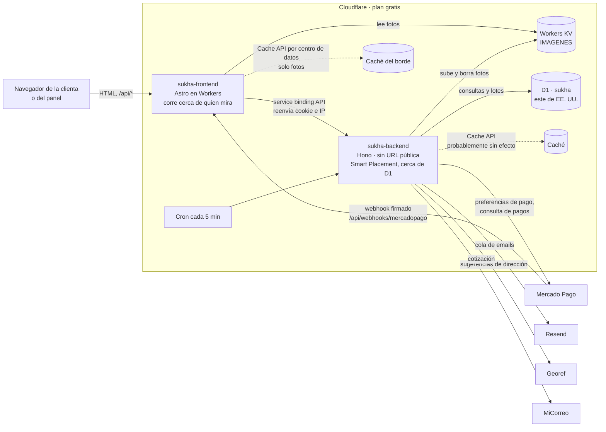

# Auditoría de arquitectura e ingeniería · Sukhä

Fecha: 2026-10-25 · Alcance: monorepo completo (`apps/frontend`, `apps/backend`, migraciones, configuración de Cloudflare). Solo lectura: no se cambió código.

## Resumen

La base está bien hecha. Los totales se calculan siempre en el servidor, el stock y los cupones se descuentan en un solo lote atómico con restricciones de la base, el webhook de Mercado Pago verifica la firma y vuelve a consultar el pago, la sesión del panel es sólida y hay 117 tests que pasan (`npx vitest run`) con los tipos del backend limpios (`npx tsc --noEmit`).

Los problemas reales están en los bordes: qué pasa cuando el backend contesta un error, cómo se reparten los límites del plan gratis de Cloudflare y qué avisos le llegan a la dueña cuando un pago sale raro. Hay **5 puntos que conviene resolver antes de lanzar** (todos chicos, entre 15 minutos y 2 horas cada uno) y el resto puede esperar.

| # | Hallazgo | Prioridad | ¿Bloquea el lanzamiento? | Esfuerzo |
|---|---|---|---|---|
| 1 | Un error del backend se guarda en la memoria compartida y rompe toda la tienda durante un minuto | Crítico | **Sí** | 30 min |
| 2 | Las páginas armadas en el servidor gastan el límite por IP de la visita, y una respuesta 429 o 500 tira la página | Crítico | **Sí** | 1 a 2 h |
| 3 | Pagos dobles y contracargos de Mercado Pago no le avisan a nadie | Importante | **Sí** | 1 a 2 h |
| 4 | La tarea programada se corta entera si falla un paso, y puede pasar el tope de 50 consultas por ejecución | Importante | **Sí** | 30 min |
| 5 | Todo el trabajo está sin guardar en git (un solo commit inicial y más de 180 archivos sin commitear) | Importante | **Sí** (decide Fabrizio) | 15 min |
| 6 | La pantalla de carritos abandonados se rompe con más de 100 variantes distintas | Importante | No, pero en las primeras semanas | 30 min |
| 7 | El tope de 100.000 ejecuciones diarias de Workers se gasta sobre todo en fotos | Importante | No | Medir: 15 min |
| 8 | KV gratis permite 1.000 escrituras por día: unas 330 fotos por día en la carga inicial | Importante | No, pero planificar la carga inicial | 1 h |
| 9 | La caché de sugerencias de dirección (Georef) del backend probablemente no hace nada | Importante | No | 1 h |
| 10 | No hay caché compartida en el borde para los datos de la tienda ni para las páginas | Importante | No | 2 a 3 h |
| 11 | Riesgo con el tope de 10 ms de CPU del plan gratis (contraseña del panel y páginas pesadas) | Importante | No (verificar) | 15 min |
| 12 | Un pago de Mercado Pago que queda "pendiente" retiene el stock para siempre | Importante | No | 30 min |
| 13 | Los tipos de la API y la máquina de estados están copiados a mano en el frontend | Mejora | No | 2 h |
| 14 | Código muerto y una dependencia sin uso | Mejora | No | 15 min |
| 15 | Utilidades repetidas en varios archivos | Mejora | No | 1 h |
| 16 | Crear un pedido lee el pedido 2 veces y la configuración 3 veces | Mejora | No | 30 min |
| 17 | La búsqueda no escapa `%` y `_` y recorre toda la tabla | Mejora | No | 30 min (FTS5: 3 h) |
| 18 | Los productos de una categoría oculta siguen abriendo por link y en el sitemap | Mejora | No | 20 min |
| 19 | La tienda no tiene Content-Security-Policy (el panel sí) | Mejora | No | 1 a 2 h |
| 20 | Sin reintento ante cortes momentáneos de D1 | Mejora | No | 30 min |
| 21 | Detalles de documentación y chequeos | Mejora | No | 30 min |

## Cómo se comunica la aplicación



Recorridos principales:

- **Página de la tienda:** el navegador pide `/producto/x` al frontend. El frontend llama al backend por el service binding (`apps/frontend/src/lib/api.ts:7`), reenviando la cookie y la IP de la visita. Los datos de cabecera y pie (`/api/tienda`, `/api/catalogo/filtros`) y la portada se guardan 60 y 30 segundos en la memoria del isolate (`apps/frontend/src/lib/tienda.ts:11-33`). El backend consulta D1 y responde JSON.
- **Llamadas del navegador:** todo `/api/*` lo reenvía tal cual el frontend (`apps/frontend/src/pages/api/[...path].ts:7`), salvo `/api/imagenes/*`, que lo atiende el propio frontend leyendo KV con caché del borde (`apps/frontend/src/pages/api/imagenes/[...clave].ts`).
- **Compra:** `POST /api/pedidos` recalcula precios, envío y cupón, y guarda pedido, reserva de stock, uso del cupón, historial y emails en un solo `d1.batch` (`apps/backend/src/services/pedidos.service.ts:150-312`). Después crea la preferencia de Mercado Pago y encola el email.
- **Pago:** Mercado Pago llama al webhook, que verifica la firma HMAC, consulta el pago a la API de Mercado Pago y aplica el cambio de estado con guardas contra carreras (`apps/backend/src/services/estados.service.ts:53-151`).
- **Tareas de fondo:** el cron de cada 5 minutos vence reservas, manda la cola de emails, borra sesiones vencidas y carritos viejos (`apps/backend/src/index.ts:13-18`).
- **Panel:** las páginas de `/admin` piden `/api/admin/yo` para verificar la sesión (recordada 30 s en memoria, `apps/frontend/src/middleware.ts:6-17`). Los formularios del panel postean a la propia página de Astro (Astro verifica el origen) y esa página llama al backend; los scripts del panel llaman `/api/admin/*` directo. El backend vuelve a exigir sesión y mismo origen en cada pedido.

## Hallazgos que bloquean el lanzamiento

### 1. Un error del backend rompe toda la tienda durante un minuto · Crítico

**Dónde:** `apps/frontend/src/lib/api.ts:21`, `apps/frontend/src/lib/tienda.ts:13-21` y `:26-32`.

**Qué pasa:** `leer()` hace `r.json()` sin mirar `r.ok`. Si el backend contesta un error (un 429 del límite por IP, o un 500 por un corte momentáneo de D1), el cuerpo `{ "error": "..." }` se parsea bien y queda guardado como si fueran los datos de la tienda. El `.catch` que borra la caché nunca se dispara porque la promesa no falla.

**Por qué importa:** esos datos los usan la cabecera y el pie de todas las páginas. Durante 60 segundos, cada visita que caiga en ese isolate recibe `tienda.contenido` indefinido y la página termina en error 500. Alcanza con que un robot que pasó su límite de pedidos por minuto sea quien dispare la renovación.

**Solución:** que `leer()` falle cuando `!r.ok`:

```ts
export const leer = async <T = any>(request: Request, ruta: string) => {
  const r = await api(request, ruta);
  if (!r.ok) throw new Error(`${ruta}: ${r.status}`);
  return r.json() as Promise<T>;
};
```

Con eso el `.catch` existente ya descarta la entrada. Opcional: si falla la renovación y había datos viejos, seguir sirviendo los viejos un rato en vez de fallar.

### 2. Las páginas del servidor gastan el límite por IP de la visita, y un 429 o 500 tira la página · Crítico

**Dónde:** `apps/frontend/src/lib/api.ts:9-12` (reenvía `cf-connecting-ip`), `apps/backend/src/routes/tienda.routes.ts:14` (`limitePublico` en todas las rutas públicas), `apps/backend/src/middlewares/acceso.middleware.ts:34-40` (120 por minuto). Páginas que solo contemplan el 404: `apps/frontend/src/pages/producto/[slug].astro:15`, `apps/frontend/src/pages/pedido/[token].astro:36`, y las que usan `leer` (`lib/listado.ts`).

**Qué pasa:** cada página armada en el servidor hace una a tres llamadas al backend, y todas cuentan contra los 120 pedidos por minuto de la IP de la visita, igual que si las hiciera el navegador. Cuando se pasa, el backend contesta 429 y la página hace `p.variantes.some(...)` sobre `{ error }` y termina en 500.

**Por qué importa:**
- Un buscador o un rastreador que recorre el catálogo rápido recibe errores 500 en lugar de páginas, y eso perjudica el posicionamiento.
- En Argentina las compañías de celular comparten una misma IP entre muchísimos usuarios (CGNAT). El día de una campaña en Instagram, muchas clientas pueden salir por la misma IP y repartirse los 120 por minuto, los 10 de checkout y los 3 pedidos nuevos por minuto (`wrangler.jsonc:28-31`).

**Solución:**
1. Que las llamadas internas no cuenten: `api()` agrega una cabecera interna (por ejemplo `x-sukha-interno: 1`), el proxy de `/api/*` la borra de lo que llega del navegador antes de reenviar (`const r = new Request(request); r.headers.delete('x-sukha-interno')`), y `limitePublico` la saltea. Es seguro porque el backend no tiene URL pública: solo se llega por el frontend.
2. En las páginas, tratar cualquier respuesta no exitosa: 404 → página 404; otra → página de error amable (o `throw`, que Astro convierte en 500 sin romper a medias).
3. Revisar los topes del checkout pensando en CGNAT: 3 pedidos nuevos por minuto por IP puede quedar corto en un lanzamiento. Subir `LIMITE_PEDIDOS` a 10 mantiene la protección contra bots (que igual chocan con `max_pedidos_pendientes` por IP y email).

### 3. Pagos dobles y contracargos no le avisan a nadie · Importante

**Dónde:** `apps/backend/src/services/pagos.service.ts:137` y `:152-164`.

**Qué pasa:**
- Si llega un segundo pago aprobado para un pedido que ya está pagado (la clienta pagó dos veces la misma preferencia, por ejemplo desde dos pestañas), se guarda la fila en `pago` y no pasa nada más (comentario de la línea 164).
- Si Mercado Pago informa `refunded` o `charged_back` (contracargo de la tarjeta), solo se actualiza la fila de `pago`; el pedido sigue "pagado" o "en preparación" (línea 137 devuelve antes).

**Por qué importa:** en el primer caso se le cobró dos veces a la clienta y nadie se entera hasta que reclama. En el segundo, la tienda puede despachar una prenda cuya plata ya volvió a la clienta.

**Solución:** sin cambiar estados, mandar el aviso que ya existe (`aviso_a_revisar`) a `email_avisos` en dos casos: (a) pago aprobado con `id_externo` distinto a otro pago aprobado del mismo pedido; (b) estado `reembolsado` en un pedido que no está `reembolsado`. Sumar una nota en `historial_estado` para que se vea en el panel. Agregar un caso de test a `pagos.test.ts` para cada uno.

### 4. La tarea programada se corta entera si falla un paso · Importante

**Dónde:** `apps/backend/src/index.ts:13-18`, `apps/backend/src/config/index.ts:22-23`, `apps/backend/src/services/estados.service.ts:155-175`.

**Qué pasa:** los cuatro pasos del cron van uno detrás de otro sin `try/catch`: si `vencerReservas` falla, no salen los emails ni se limpian sesiones. Además, el plan gratis permite **50 consultas a D1 por ejecución** (un `batch` cuenta como una; [límites de D1](https://developers.cloudflare.com/d1/platform/limits/)). Cancelar una reserva vencida usa unas 5 (cargar pedido = 2, lote = 1, recargar = 2). Con `PEDIDOS_POR_TANDA = 20` el peor caso son ~100 consultas, y mandar 10 emails suma ~32 más (`emails.service.ts:69-122`, 3 por email). Alcanza con 4 reservas vencidas y 10 emails en cola para pasar el tope.

**Por qué importa:** en un momento de mucho movimiento (o con pedidos falsos de un bot), los emails de "pago aprobado" se atrasan tanda tras tanda.

**Solución:**
- Envolver cada paso en su propio `try/catch` con `console.error`, o usar `Promise.allSettled` con pasos independientes.
- Bajar las tandas para entrar holgado: `PEDIDOS_POR_TANDA = 6`, `EMAILS_POR_TANDA = 8`. Cada 5 minutos alcanzan de sobra para una tienda de este tamaño.
- Opcional: `cambiarEstado` puede devolver el pedido sin recargarlo cuando quien llama no lo usa (ahorra 2 consultas por cancelación).

### 5. El trabajo no está guardado en git · Importante (decide Fabrizio)

**Dónde:** el repositorio tiene un solo commit (`17e9386`) y `git status` muestra 127 archivos modificados y unos 60 sin seguimiento (migraciones 0005 a 0010, servicios, páginas del panel).

**Por qué importa:** varios hilos de Claude trabajan en la misma carpeta a la vez. Si un cambio sale mal no hay a dónde volver, y al desplegar no queda registro de qué versión exacta está en producción. Las migraciones 0005 a 0010 ya corrieron en staging y no están guardadas en ningún commit.

**Solución:** commitear localmente antes de cada despliegue (git solo local, sin remoto ni push, como ya está acordado). Es una decisión de Fabrizio; ningún hilo debería commitear sin que lo pida.

## Importantes, para después del lanzamiento

### 6. Carritos abandonados se rompe con más de 100 variantes distintas

**Dónde:** `apps/backend/src/services/carritos.service.ts:77-89`.

**Qué pasa:** junta las variantes de hasta 300 carritos y las manda como `IN (?, ?, ...)`. D1 acepta como máximo **100 parámetros por consulta** ([límites de D1](https://developers.cloudflare.com/d1/platform/limits/)). Con unas semanas de visitas se pasa y la pantalla del panel da error.

**Solución:** mandar los ids como un solo parámetro JSON: `WHERE v.id IN (SELECT value FROM json_each(?))` con `.bind(JSON.stringify(ids))`. El mismo patrón conviene en cualquier `IN` armado desde una lista que pueda crecer (hoy los demás están acotados a 30 por la validación).

### 7. El tope diario de Workers se gasta en fotos

**Dónde:** `apps/frontend/src/pages/api/imagenes/[...clave].ts`.

**Qué pasa:** el plan gratis permite **100.000 ejecuciones por día** ([límites de Workers](https://developers.cloudflare.com/workers/platform/limits/)). Los archivos estáticos (CSS, JS) no cuentan, pero cada foto pasa por el Worker aunque salga de la caché. Un listado de 24 productos son unas 25 ejecuciones; con carga perezosa (ya está en casi todas las imágenes) son menos, y el navegador las guarda para siempre (`immutable`), así que una misma clienta no las vuelve a pedir.

**Por qué importa:** como orden de magnitud, el techo está en algunos miles de visitas por día. Para una tienda que arranca sobra, pero conviene saberlo antes de una campaña grande. Pasado el tope, Cloudflare devuelve error 1027 hasta la medianoche UTC.

**Solución:** medir antes de optimizar. En el panel de Cloudflare (Workers → sukha-frontend → Métricas) mirar las ejecuciones diarias después de la primera semana. No está documentado si las llamadas por service binding al backend suman al mismo tope: verificarlo mirando las métricas de sukha-backend. Si algún día se acerca al límite, la salida es el plan pago de Workers, que requiere tarjeta: es una decisión de Fabrizio.

### 8. KV gratis: 1.000 escrituras por día

**Dónde:** `apps/backend/src/services/imagenes.service.ts:20-27`, comentario en `apps/backend/wrangler.jsonc:24`.

**Qué pasa:** cada foto de producto son 3 escrituras (chico, mediano, grande). Eso da unas 330 fotos por día; los borrados tienen su propio tope de 1.000. Pasado el tope, `kv.put` falla y el panel muestra el genérico "Ocurrió un error inesperado".

**Por qué importa:** la carga inicial del catálogo (por ejemplo 100 productos con 4 fotos = 1.200 escrituras) no entra en un día.

**Solución:** atrapar el error de cuota de KV en `subirImagen` y devolver un `ErrorApp(429, 'Se llegó al máximo de fotos por hoy. Seguí mañana.')`. Planificar la carga inicial en dos o tres días. Ver el uso en el panel de Cloudflare (KV → Métricas).

### 9. La caché de Georef del backend probablemente no hace nada

**Dónde:** `apps/backend/src/controllers/tienda.controller.ts:106-117`.

**Qué pasa:** la documentación de Cloudflare dice que la Cache API funciona en Workers con dominio propio ([Cache API](https://developers.cloudflare.com/workers/runtime-apis/cache/)). El backend no tiene dominio ni ruta (solo service binding), así que lo más probable es que `cache.put` no guarde nada. Y si guardara, sería en el centro de datos de EE. UU. donde corre el backend.

**Por qué importa:** cada búsqueda de calle o localidad va a Georef, que es una API pública del Estado sin garantías; más llamadas, más lentitud y más chances de que corte.

**Solución:** verificar con un `console.log` de `cacheada` en staging. Si se confirma, guardar las respuestas en la tabla `cache_externa` que ya existe (con vencimiento de 24 h), igual que el token de MiCorreo.

### 10. Sin caché compartida en el borde para datos y páginas

**Dónde:** `apps/frontend/src/lib/tienda.ts:11-33`, `apps/frontend/src/middleware.ts`.

**Qué pasa:** los datos compartidos se guardan en la memoria del isolate. Con poco tráfico los isolates se crean y se descartan seguido, así que la memoria casi nunca está tibia: cada página termina cruzando a EE. UU. (el backend corre junto a la base), y la de categoría lo hace dos veces seguidas (datos de la tienda, después el listado).

**Por qué importa:** cada cruce son unos 150 ms desde Argentina, y cada render consume CPU del tope de 10 ms.

**Solución:** en el frontend (que sí tiene dominio propio), guardar en `caches.default` con 60 segundos de vida las respuestas de `/api/tienda`, `/api/catalogo/filtros` y `/api/portada`, y opcionalmente el HTML de páginas públicas sin cookie (portada, producto, categoría). Es el mismo patrón que ya usa la ruta de fotos. El panel ya tarda "menos de un minuto" en verse, así que no cambia la experiencia.

### 11. Tope de 10 ms de CPU del plan gratis

**Dónde:** `apps/backend/src/utils/crypto.ts:2` (PBKDF2 con 100.000 iteraciones), render de Astro en el frontend.

**Qué pasa:** el plan gratis da 10 ms de CPU por ejecución, también para el cron ([límites de Workers](https://developers.cloudflare.com/workers/platform/limits/)). Calcular la contraseña con 100.000 iteraciones suele llevar varias decenas de milisegundos de CPU, y las páginas con muchas tarjetas también suman. Cloudflare tolera excesos ocasionales, por eso funciona en staging.

**Solución:** verificar en Workers Logs de los dos workers si aparecen ejecuciones con resultado "exceededCpu". Si aparecen solo en el login, lo razonable es dejarlo como está (se entra pocas veces y Cloudflare tolera excesos ocasionales) y revisarlo solo si el login empieza a fallar; bajar las iteraciones debilita las contraseñas. Si aparecen en páginas, la solución es la caché del punto 10.

### 12. Un pago pendiente de Mercado Pago retiene el stock sin límite

**Dónde:** `apps/backend/src/services/estados.service.ts:159`.

**Qué pasa:** `vencerReservas` saltea los pedidos con un pago de Mercado Pago en estado `pendiente`. Si ese pago nunca se resuelve (queda `in_process` o el aviso final se pierde), el stock queda tomado para siempre.

**Solución:** cancelar igual cuando el pago pendiente tiene más de 72 horas (`pago.creado_en`), con una nota, y mandar `aviso_a_revisar`.

## Mejoras

### 13. Tipos y reglas copiados a mano entre frontend y backend

**Dónde:** el tipo `Pedido` en `apps/frontend/src/pages/pedido/[token].astro:14-33`; los tipos de `apps/frontend/src/lib/formato.ts`; la máquina de estados en `apps/frontend/src/lib/panel.ts:57-68`, copia de `apps/backend/src/services/estados.service.ts:8-18`.

**Por qué importa:** cuando cambia la API, el frontend sigue compilando con el tipo viejo y el error aparece recién en producción.

**Solución:** exportar los tipos de respuesta desde el backend (`export type Seguimiento = Awaited<ReturnType<typeof seguimiento>>`) e importarlos en el frontend con `import type` por ruta relativa del monorepo (no agrega nada al bundle). Para los estados, que `GET /api/admin/pedidos/:id` devuelva `siguientes: TRANSICIONES[estado]` y el panel use eso. No hace falta adoptar el cliente RPC de Hono ni pasar el service binding a RPC: con los tipos alcanza.

### 14. Código muerto y una dependencia sin uso

- `apps/backend/src/controllers/publico.controller.ts:13-33` y `apps/backend/src/routes/index.ts:10`: la ruta de fotos del backend no se usa nunca, porque la ruta más específica `apps/frontend/src/pages/api/imagenes/[...clave].ts` la tapa. Borrarla deja un solo lugar que sirve fotos.
- `apps/backend/src/services/catalogo.service.ts:236-244`: `seccionesPortada` no tiene llamadas (la reemplazó `portada-secciones.service.ts`).
- `apps/backend/package.json`: `@sentry/cloudflare` está instalada y no se importa en ningún lado.
- `apps/frontend/src/_panel4.cjs`: un script de una sola vez que reescribía archivos, olvidado dentro de `src/`. Confirmar que ningún hilo lo esté usando y borrarlo.

### 15. Utilidades repetidas

- La marca de tiempo SQL `strftime('%Y-%m-%dT%H:%M:%fZ', 'now')` está definida como constante en tres servicios (`pedidos.service.ts:146`, `estados.service.ts:40`, `carritos.service.ts:6`) y escrita a mano en muchos más. Una sola constante en `utils/http.ts` junto a `ahora()`.
- El HTML de la lista de prendas del email está dos veces en `apps/backend/src/services/emails.service.ts` (`:44` y `:59-61`); `armarEmail` puede usar `envolverEmail`.
- `json()` con escape de `<` está repetida en tres páginas (`recuperar/[codigo].astro:11`, `admin/portada.astro:25`, `admin/productos/carga-rapida.astro:23`) y ya existe `jsonLd` en `lib/formato.ts:144` que hace lo mismo.
- `esc()` está en `scripts/carga-rapida.ts:35` y `scripts/portada.ts:248`.
- `pesos()` está en `lib/panel.ts:30` y en `lib/formato.ts`.

### 16. Lecturas repetidas al crear un pedido

**Dónde:** `apps/backend/src/controllers/tienda.controller.ts:138-151`.

Después de crear el pedido se lo carga (`cargarPedido`), `crearPreferencia` lee la configuración, y `seguimiento` vuelve a cargar el pedido y la configuración: la configuración se lee tres veces en total contando `cotizar`. Con el backend junto a la base cada lectura cuesta poco, pero son consultas que cuentan para el tope de 50 del punto 4. Pasar el pedido y la configuración ya leídos.

### 17. Búsqueda

**Dónde:** `apps/backend/src/services/catalogo.service.ts:106`.

`like('%' + q + '%')` no escapa `%` ni `_` (buscar "50%" trae cualquier cosa) y recorre toda la tabla. Con pocos cientos de productos está bien. Escapar los comodines ahora; pasar a FTS5 (incluido en D1) cuando el catálogo pase de un par de miles o se quiera buscar sin tildes.

### 18. Los productos de una categoría oculta siguen a la vista

**Dónde:** `apps/backend/src/services/catalogo.service.ts:151-179` (ficha del producto), `:202-207` (relacionados) y `:247-256` (sitemap).

Los listados filtran con `categoriaVisible`, pero la ficha, los relacionados y el sitemap solo miran que el producto esté publicado. Si la dueña oculta una categoría, sus productos desaparecen de los listados pero siguen abriendo por link directo y siguen en el sitemap que leen los buscadores. Agregar el `leftJoin(padre)` y `categoriaVisible` en esas tres consultas, como en el listado.

### 19. La tienda no tiene Content-Security-Policy

**Dónde:** `apps/frontend/src/middleware.ts:41-60`.

El panel tiene una política estricta; la tienda no. Las demás defensas están (Astro escapa todo, los JSON-LD escapan `<`). Agregar una política para la tienda requiere revisar los scripts en línea de las islas de Astro y de `speculationrules`, por eso queda para después.

### 20. Cortes momentáneos de D1

D1 devuelve de vez en cuando errores de red pasajeros. Hoy terminan en 500. Un reintento único en las lecturas públicas (catálogo, producto, tienda) los esconde. No reintentar escrituras fuera de las que ya son idempotentes.

### 21. Documentación y chequeos

- `README.md:61-65`: "Antes del primer deploy" empieza en el paso 3 (faltan 1 y 2).
- `npm run check` no chequea los tipos del frontend (`astro build` no lo hace). Si algún día se agregan tipos compartidos (punto 13), conviene `astro check`.
- Staging corre en `workers.dev`, donde la Cache API no tiene efecto: staging no prueba la caché de fotos ni la del punto 10.

## Capacidad del plan gratis, de un vistazo

| Recurso | Tope gratis | Qué lo consume | Cuándo preocupa |
|---|---|---|---|
| Ejecuciones de Workers | 100.000 por día | Páginas, llamadas `/api/*` y cada foto | Algunos miles de visitas por día (punto 7) |
| CPU por ejecución | 10 ms | Render de páginas, login | Ver Workers Logs (punto 11) |
| Consultas D1 por ejecución | 50 (un `batch` = 1) | Cron, crear pedido | Cron con varias reservas vencidas (punto 4) |
| Parámetros por consulta D1 | 100 | Listas `IN (...)` | Carritos abandonados (punto 6) |
| Tamaño de D1 | 500 MB | Pedidos, historial | Lejos: años de pedidos |
| Escrituras KV | 1.000 por día | 3 por foto | Carga inicial del catálogo (punto 8) |
| Lecturas KV | 100.000 por día | Fotos que no están en la caché | Lejos, gracias a la caché |
| Emails de Resend | 100 por día, 3.000 por mes | ~4 emails por pedido | Unos 25 pedidos por día; la cola ya reintenta al día siguiente |

D1 guarda 7 días de historial para restaurar la base a cualquier minuto (Time Travel, incluido gratis), además de los respaldos manuales de `npm run db:backup`.

## Lo que está bien y conviene no tocar

- **Dinero y stock:** totales recalculados en el servidor (`pedidos.service.ts:105-144`), reserva atómica con `CHECK (stock >= 0)` y tope de usos del cupón en la base, clave de idempotencia por pedido, por preferencia de Mercado Pago y por email de Resend.
- **Estados:** cada sentencia del cambio de estado lleva la guarda "el pedido sigue en el estado esperado" y el cambio va último; dos avisos simultáneos no aplican el pago dos veces (`estados.service.ts:50-151`).
- **Webhook:** firma HMAC con comparación en tiempo constante, nunca confía en el cuerpo y responde 200 a pagos desconocidos para que Mercado Pago no reintente sin fin.
- **Panel:** cookie `__Host-` con `HttpOnly`, `Secure` y `SameSite=Lax`; en la base solo el hash del token; PBKDF2 con hash señuelo para no delatar emails; límite de 5 intentos por minuto; mismo origen en el backend y en Astro; CSP estricta y `no-store`.
- **Datos personales:** IP guardada como hash, CSV protegido contra fórmulas de Excel, seguimiento por token aleatorio de 64 caracteres, páginas del pedido sin indexar.
- **Arquitectura:** backend sin URL pública, fotos servidas cerca de quien mira con claves que nunca se reutilizan, Smart Placement junto a la base, migraciones numeradas que nunca editan una anterior.
- **Calidad:** 117 tests en verde y tipos del backend limpios al momento de esta auditoría.

## Comparación con proyectos similares

La combinación Hono + D1 + Drizzle detrás de un frontend Astro en Workers es la que muestran las plantillas oficiales de Cloudflare ([cloudflare/templates](https://github.com/cloudflare/templates), por ejemplo la de panel de administración con Astro y D1). Sukhä va más allá que esas plantillas en lo que más importa para una tienda: transacciones atómicas, idempotencia y verificación de pagos.

Donde las tiendas de este tipo suelen invertir después, y Sukhä todavía no, es en la caché del borde (punto 10) y en manejar los límites de la plataforma como parte del diseño (puntos 4, 6, 7 y 8). Ninguna de esas mejoras necesita servicios pagos.

No se recomienda: pasar a R2 (requiere tarjeta), sumar Sentry (ya hay Workers Logs), ni cambiar el ORM o el estilo de consultas. Drizzle y SQL a mano conviven bien acá: SQL directo donde hacen falta lotes atómicos con guardas, Drizzle en el resto.

## Cómo repetir los chequeos

```sh
cd apps/backend
npx vitest run       # 117 tests
npx tsc --noEmit     # tipos del backend
```

Para los límites, mirar en el panel de Cloudflare las métricas de sukha-frontend, sukha-backend, la base `sukha` y el KV de fotos después de la primera semana en producción.
